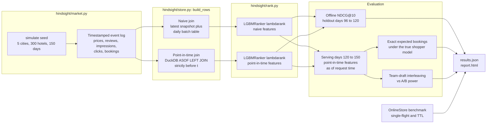
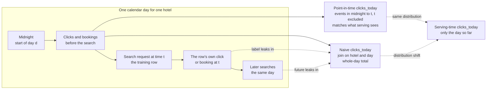
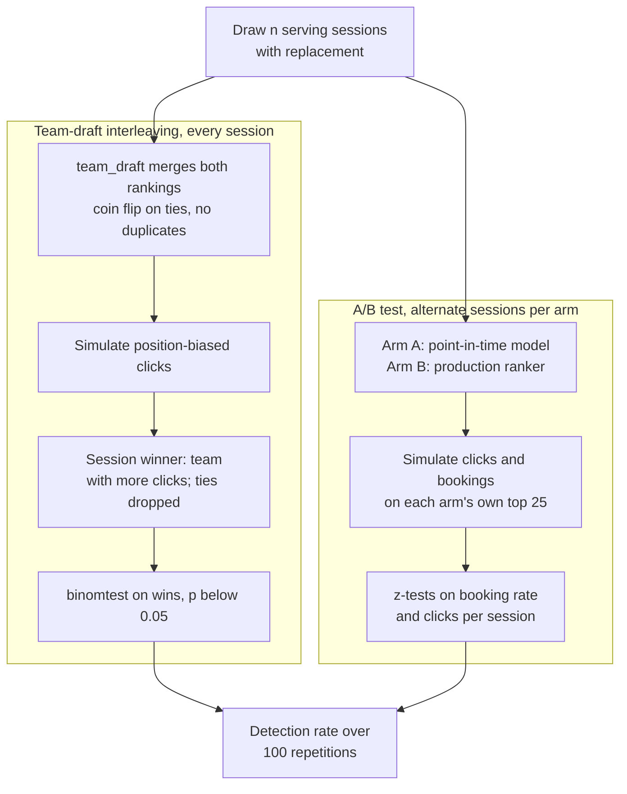
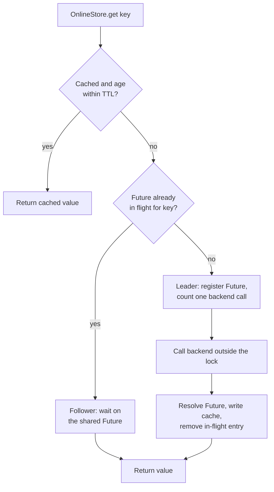

# Hindsight

[](https://github.com/ombdj1209/hindsight/actions/workflows/ci.yml)

**The offline gain that disappears in production.** A point-in-time-correct feature store and learning-to-rank pipeline for accommodation search. It shows, with exact numbers, how a feature table that looks harmless leaks the label, makes a model look best offline, and then makes it lose to the old production ranker at serving time. It also measures how much faster interleaving detects a better ranker than an A/B test, and what request coalescing does to a hot-key burst on the online store.

All hotels, prices, reviews and searches are synthetic, generated by a marketplace simulator that knows every shopper's true click and booking probabilities.

## At a glance

| | |
|---|---|
| Question | How much does a label-leaking feature join cost, and how would you catch it? |
| Offline | The leaky model scores **0.800** NDCG@10 on its own leaky holdout, versus 0.742 for the point-in-time model |
| Serving | The leaky model delivers **−14.6%** bookings against production; the point-in-time model delivers **+11.8%** |
| Root cause | The naive model puts **83% to 90%** of its split gain on `clicks_today`, which at serving time holds only the morning's clicks |
| Experimentation | Team-draft interleaving reaches 80% power at about **250 sessions**; A/B on bookings is at 30% power after 2,000 |
| Online store | Single-flight coalescing cuts backend calls by 70% at the same latency; adding a 50 ms TTL leaves **40** calls for 2,000 lookups |
| Reproduce | `python run_eval.py`, about 100 s on one CPU core; `python -m pytest -q` runs 8 tests |
| Runtime | Python 3.11+ |

## Tech stack

| Layer | Technology | Used for |
|---|---|---|
| Language | Python 3.11+ | Whole codebase; CI covers 3.11, 3.12 and 3.13 |
| Numerics | NumPy | Simulator (seeded `default_rng`), click and booking probabilities, NDCG, exact online value, percentiles |
| Data frames | pandas | Event log tables, cumulative counters, the naive snapshot and daily-table joins, feature assembly |
| Point-in-time joins | DuckDB, in-memory | Six `ASOF LEFT JOIN`s over cumulative event tables, each with a strict `>` time condition |
| Ranking | LightGBM `LGBMRanker`, `objective="lambdarank"` | LambdaMART models trained on naive and point-in-time features; split-gain feature importance |
| Statistics | SciPy `scipy.stats.binomtest`, `scipy.stats.norm` | Sign test on interleaving wins; z critical value for the A/B tests |
| Concurrency | stdlib `threading.Lock`, `threading.Thread`, `concurrent.futures.Future` | Single-flight coalescing in `OnlineStore`; the 32-thread hot-key benchmark |
| Other stdlib | `collections.deque`, `dataclasses`, `time.monotonic` / `perf_counter`, `argparse`, `json`, `html`, `pathlib`, `platform` | Rolling 7-day popularity in the simulator, the `Market` container, TTL ageing and latency timing, CLI, results file, HTML report |
| Testing | pytest | 8 tests in `tests/test_hindsight.py` |
| Packaging and tasks | setuptools via `pyproject.toml`, Make | Editable install with a `dev` extra; `install`, `test`, `eval`, `quick` targets |
| CI and maintenance | GitHub Actions (Python 3.11–3.13), Dependabot | Install and test on every push to `main` and every pull request; monthly grouped updates for pip and Actions |

## Repository layout

```
hindsight/
  market.py        marketplace simulator: hotels, daily prices, reviews, launches,
                   position-biased clicks, bookings, popularity feedback
  store.py         offline store (naive and point-in-time build_rows) and OnlineStore
                   (single-flight coalescing, TTL)
  rank.py          LambdaMART training, NDCG@k, candidate generation, exact online value
  interleave.py    team-draft interleaving and A/B power simulation
  report.py        self-contained HTML report rendered from results.json
run_eval.py        reproduces every number in this README; writes results/
results/
  results.json     committed results of the full three-market run
  report.html      rendered report
tests/
  test_hindsight.py
pyproject.toml     package metadata, dependencies, pytest configuration
Makefile           install, test, eval, quick
.github/
  workflows/ci.yml GitHub Actions test matrix
  dependabot.yml   dependency update schedule
SECURITY.md
LICENSE
```

## Why this exists

Booking.com has written about ranking at scale: signal definition, feature representation, leakage, experiment speed and low-latency feature serving, plus a feature platform serving very high request rates. The failure it warns about is the one that is easiest to ship by accident: **training on features the model will not have at serving time.** Hindsight builds that failure deliberately, measures its damage, and shows the fix.

## Methodology

### Pipeline



| Piece | File |
|---|---|
| Marketplace: quality, daily prices, reviews, launches, position-biased clicks, bookings, popularity feedback | `hindsight/market.py` |
| Offline store (naive and point-in-time joins) and online store (single-flight coalescing, TTL) | `hindsight/store.py` |
| LambdaMART training, NDCG, exact online value | `hindsight/rank.py` |
| Team-draft interleaving and A/B power analysis | `hindsight/interleave.py` |

### Simulated market

`simulate(seed)` creates 5 cities of 60 hotels each. Every hotel has a latent quality, a star rating, a distance and a base price; a quarter launch part-way through the period. Prices follow a daily random walk with a weekend uplift. Reviews arrive as a Poisson process and are noisy readings of quality. Each city receives 20 searches a day for 150 days. Each search is ranked by the **production popularity ranker** (bookings in the last 7 days, with a little jitter) and shows 25 results. Shoppers examine position *k* with probability `1 / (1 + k)^0.7`, click with `sigmoid(u − 0.4)` and book with `sigmoid(u − 3.4)`, where utility *u* combines quality, log price scaled by the shopper's price sensitivity, and distance. A shopper books at most one hotel. Every event carries a continuous timestamp.

### Features and labels

Both joins produce the same twelve features: `log_price`, `price_rel`, `review_score` (shrunk towards a prior of 7.5 with weight 3), `log_reviews`, `bookings_7d`, `ctr` (smoothed), `clicks_today`, `imps_today`, `bookings_today`, `stars`, `distance`, `age_days`. Graded relevance is 2 for a booking, 1 for a click and 0 otherwise.

**The leak is ordinary.** A daily batch table holds per-hotel clicks, impressions and bookings for each day. Joined on (hotel, day), it gives every training row the *full* day's totals, including that row's own click or booking and every later search that day. At serving time only the part of the day that has already happened exists. The point-in-time join reconstructs "today so far" (and 7-day bookings, review score, CTR) from events strictly before each search. The naive path also takes review, 7-day booking, CTR and price values from a single latest snapshot, as a batch table would hold them on the day the training job runs.



### Point-in-time join mechanics

Reviews, bookings and impressions are turned into per-hotel cumulative counters (`_cum`, plus a per-instant maximum for same-timestamp impressions). The query table carries three timestamps per row: *t*, *t − 7* and midnight of the row's day. DuckDB then runs six `ASOF LEFT JOIN`s, each matching the most recent counter row with `q.t > counter.t`. Windowed features are differences of two lookups: 7-day bookings is the cumulative count before *t* minus the count before *t − 7*; "today so far" is the count before *t* minus the count before midnight.

### Training, holdout and serving

Logged impressions from days 0 to 120 are joined both ways. Training runs on days 0 to 96, the offline holdout is days 96 to 120, and serving is days 120 to 150 (3,000 searches per market). Both models use identical LightGBM settings: 300 trees, learning rate 0.05, 31 leaves, 40 minimum child samples, row subsampling 0.8, column subsampling 0.9.

At serving time every launched hotel in the searched city is a candidate, and every feature is built with the point-in-time join as of the request, which is what an online store would return. Each ranker orders the candidates, the top 25 are shown, and value is the exact expected number of bookings: the sum over positions of examination × P(click) × P(book | click) under the true shopper model. The oracle ranks by true P(click) × P(book | click).

### Interleaving versus A/B



For bookings the A/B test is a pooled two-proportion z-test on sessions with a booking; for clicks it uses a Poisson approximation for click counts. A detection means the point-in-time model is significantly better at the 5% level.

### Online store and request coalescing



The cache check and the in-flight lookup happen under one `threading.Lock`; the backend call does not. With `coalesce=False` every request is a leader. The benchmark issues 2,000 lookups from 32 threads over 40 keys drawn from a Zipf distribution (exponent 1.6), against a backend that sleeps 3 ms.

## Results

`python run_eval.py`: 100 s on one CPU core. Three independently simulated markets (5 cities, 300 hotels, 150 days, 15,000 searches each). Training runs on days 0 to 96, the offline holdout is days 96 to 120, and serving is days 120 to 150 (3,000 searches per market). Values are the mean with the min and max across markets. The committed `results/results.json` records the environment of the run.

### Offline, the leaky model wins

| Model and holdout | NDCG@10 |
|---|---|
| Naive-join model, evaluated on a naive-join holdout | **0.800** (0.794 to 0.811) |
| Point-in-time model, point-in-time holdout | 0.742 (0.732 to 0.759) |
| Production popularity ranker, point-in-time holdout | 0.736 (0.726 to 0.749) |
| Naive-join model, point-in-time holdout | 0.634 (0.605 to 0.672) |

A team evaluating the way it trained (naive features on both sides) would report a clear win: +0.058 NDCG over the point-in-time model. The same model on honest features is the worst of the four.

### At serving time, it loses to production

Exact expected bookings per 1,000 searches under the true shopper model, with every feature as of request time:

| Ranker | Bookings per 1,000 searches | vs production |
|---|---|---|
| Production popularity | 450.9 (389.0 to 524.6) | baseline |
| **Naive-join model** | **385.1** (309.8 to 483.4) | **−14.6%** |
| **Point-in-time model** | **504.0** (438.1 to 584.5) | **+11.8%** |
| Oracle (true propensities) | 541.0 (476.1 to 626.0) | +20.0% |

**The "offline winner" would have cost 15% of bookings**, while the correctly built model gains 12% and captures 59% of the available headroom. The reason is visible in the models: the naive model puts **83% to 90% of its split gain on `clicks_today`**, a feature that at serving time holds only the morning's clicks. The point-in-time model relies on 7-day bookings and CTR, which mean the same thing in training and serving.

### Detecting the better ranker: interleaving versus A/B

Share of 100 simulated experiments that detect the point-in-time model as better than production at p < 0.05 (market 1):

| Sessions | Team-draft interleaving (clicks) | A/B on clicks | A/B on bookings |
|---|---|---|---|
| 50 | 17% | 6% | 1% |
| 100 | 43% | 14% | 7% |
| 250 | **81%** | 37% | 7% |
| 500 | **96%** | 81% | 9% |
| 1,000 | 100% | 99% | 21% |
| 2,000 | 100% | 100% | 30% |

Interleaving reaches 80% power with about **250 sessions**. A/B on clicks needs about twice that. A/B on bookings, the metric the business cares about, is still at 30% power at 2,000 sessions. That is the case for the usual two-stage process: interleave to shortlist rankers fast, then run a conventional A/B test on bookings for the finalist.

### Online store under a hot-key burst

2,000 lookups from 32 threads over 40 hotels with a Zipf-skewed popularity, against a backend taking 3 ms per call:

| Online store | Backend calls | p50 | p99 |
|---|---|---|---|
| No coalescing | 2,000 | 3.10 ms | 3.49 ms |
| Single-flight | 598 (−70%) | 3.14 ms | 3.62 ms |
| Single-flight + 50 ms TTL | **40** | 0.0005 ms | 3.24 ms |

Single-flight alone removes 70% of backend load at identical latency: concurrent requests for the same hotel share one call. A 50 ms freshness budget on top collapses the burst to one call per key.

## Key engineering decisions and trade-offs

- **"Strictly before" is the whole rule.** Every ASOF join uses `>`, not `>=`, so a search never sees its own impressions, clicks or bookings (tested against the raw event log for sampled rows). The cost is that simultaneous events are invisible to each other, which is the conservative choice.
- **Windowed features are two ASOF lookups.** 7-day bookings is the cumulative count at *t* minus the cumulative count at *t − 7*; "today so far" subtracts the count at midnight. No per-row scans, and the same definition works for any window.
- **One feature definition, two join strategies.** The naive and point-in-time paths emit identical columns and share the derived-feature code, so the only variable between the two models is the join. Serving always uses the point-in-time path, which is what makes the naive model's collapse attributable to the join and nothing else.
- **Online value is exact, not sampled.** Expected bookings for a ranked list is the sum over positions of examination × click × book probabilities, so ranker comparisons carry no simulation noise. The trade-off is that it depends on the simulator's shopper model being the truth, which only a simulation can offer.
- **The production ranker creates feedback.** Logged data comes from a popularity ranker, so popular hotels get more exposure and more bookings, as in real marketplaces. Both models learn from the same biased logs.
- **DuckDB for the joins, pandas for the rest.** ASOF joins are the natural primitive for point-in-time lookups and DuckDB runs them in process over pandas frames with no server. Cumulative counters are built in pandas; the cost is holding the full event log in memory, which is fine at this scale.
- **Single-flight with a lock and a `Future`.** Coalescing needs no event loop and no extra dependency; the lock is held only for dictionary operations, never across the backend call. A per-store TTL layers freshness on top, trading staleness (at most 50 ms in the benchmark) for backend load.
- **Power is estimated by simulation, not formula.** Repeated experiments on the actual serving sessions capture position bias and the correlation of clicks within a list, which closed-form power calculations would ignore.

## Testing strategy

`python -m pytest -q` runs 8 tests against a separate seeded market, using a 300-session sample of logged impressions:

| Test | What it proves |
|---|---|
| `test_simulation_is_deterministic` | The same seed produces an identical impression log, so every result is reproducible |
| `test_point_in_time_features_only_use_strictly_earlier_events` | For 150 sampled rows, review count, 7-day bookings, impressions today and clicks today equal brute-force counts over the raw event log restricted to events strictly before *t* |
| `test_naive_daily_features_contain_the_rows_own_outcome` | Every booked row's naive `bookings_today` is at least 1, and point-in-time `clicks_today` never exceeds the naive value: the leak exists and is one-directional |
| `test_ndcg_is_one_for_the_ideal_order` | Scoring by the true labels gives NDCG@10 of exactly 1 |
| `test_sorting_by_true_propensity_is_optimal` | Ordering by P(click) × P(book) beats random orderings on exact online value |
| `test_team_draft_is_a_fair_duplicate_free_merge` | Over 200 random pairs, the interleaved list has 25 distinct items and neither team ever leads by more than one pick |
| `test_examination_decays` | Examination probability is strictly decreasing with position |
| `test_single_flight_collapses_concurrent_identical_lookups` | 16 concurrent lookups for one key produce one backend call and the correct value for all; with coalescing off, 8 lookups produce 8 calls |

The tests check invariants and correctness against brute force. They do not assert the headline numbers; those come from `run_eval.py` and are committed in `results/results.json`. CI runs the suite on Python 3.11, 3.12 and 3.13.

## Run it

```bash
pip install -e ".[dev]"    # or: make install
python -m pytest -q        # or: make test   (8 tests)
python run_eval.py         # or: make eval   (about 2 minutes, three markets)
python run_eval.py --quick # or: make quick  (one market, fewer power simulations)
open results/report.html
```

`run_eval.py` overwrites `results/results.json` and `results/report.html`. Timing-based figures (runtime, coalescing latencies) will vary by machine; the simulation and model results are seeded.

## Limitations

- Serving-period counters evolve under the production ranker, not under the ranker being evaluated, so the feedback of a new ranker on popularity features is ignored.
- Booking rates are higher than on a real platform, to keep labels dense in a small simulation.
- There is no Kafka or Redis here. The event log is a DataFrame and the online store is in-process; the definitions and the single-flight logic are what carry over.
- Three markets give the direction and rough size of each effect, not tight confidence intervals.
- The power study uses one market, and the coalescing benchmark uses a sleeping backend rather than a real network call.

## Production-readiness gaps

- **Error propagation in single-flight.** If the backend raises, the leader never resolves the shared `Future`, so coalesced followers would wait indefinitely. A production version must set the exception on the `Future` and apply a timeout.
- **Cache management.** The online cache is an unbounded dict with a single store-wide TTL. Production needs eviction, per-feature freshness budgets and freshness metadata returned to callers.
- **Single process.** Coalescing is per process; a fleet needs it per node plus protection at the shared store.
- **Batch-only offline store.** Features are recomputed from the full event log per call with an in-memory DuckDB connection; there is no incremental materialisation, backfill or schema registry.
- **No model lifecycle.** No model registry, versioning, drift monitoring or automatic leakage checks in the training pipeline.
- **No observability.** The store counts backend calls but exports no metrics, traces or logs.

### Next steps

1. Stream the event log through Kafka (Redpanda locally) and materialise the online store in Redis with freshness metadata per feature.
2. A leakage detector: flag features whose importance collapses when the training join is switched to point-in-time.
3. Counterfactual evaluation of new rankers with logged propensities, next to interleaving.
4. Diversity and supplier-exposure constraints in re-ranking, with their cost in bookings.

## Security

See [SECURITY.md](SECURITY.md) for supported versions and how to report a vulnerability privately. The project uses only synthetic, seeded data, opens no network ports and needs no credentials.

## License

MIT. See [LICENSE](LICENSE).
